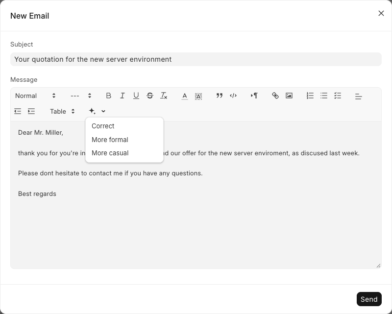
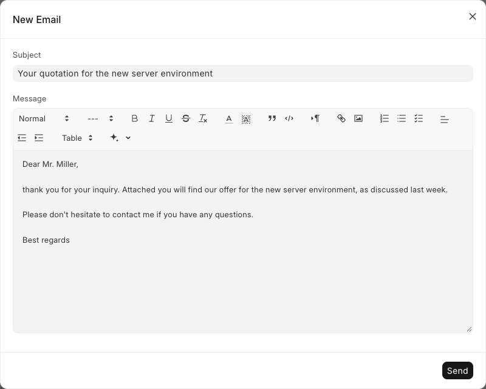
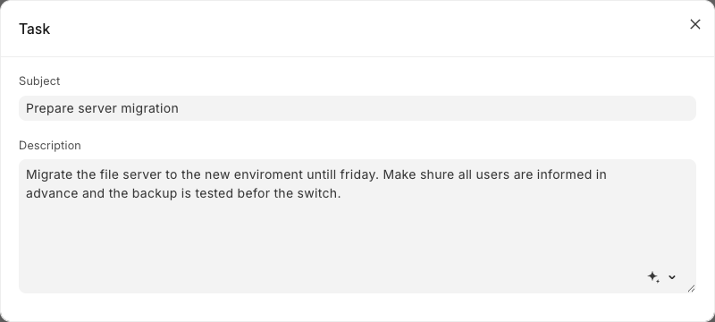
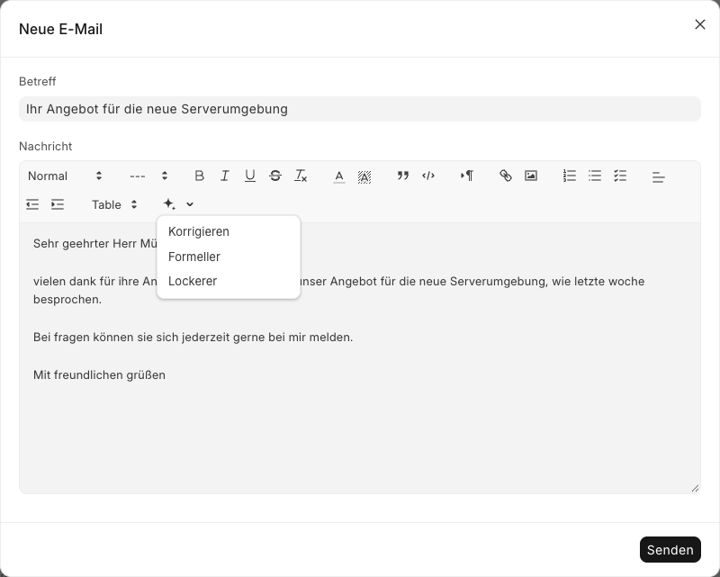
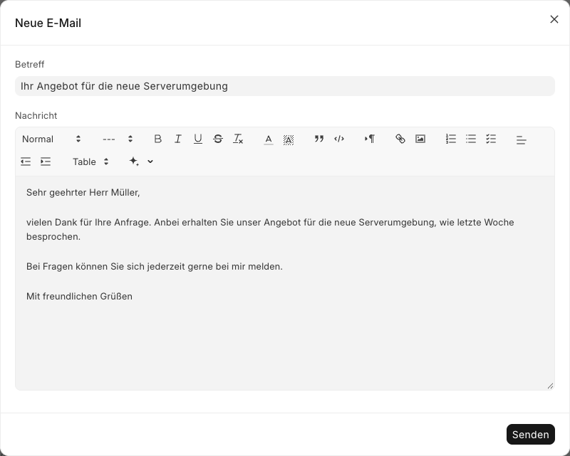
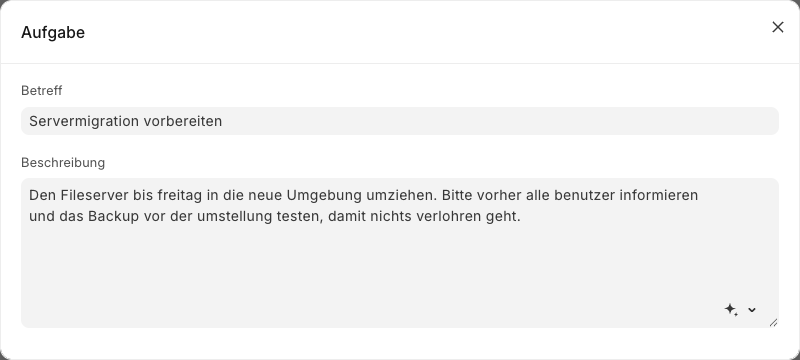
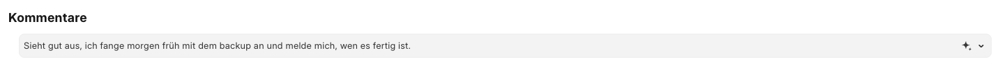

# Frappe AI Writer

**English** · [Deutsch](#deutsch)

AI proofreading, write-out and translation for Frappe and ERPNext text fields.

A sparkle button appears in every desk text field. One click corrects spelling, grammar and punctuation, either of the selected text or of the whole field, without leaving the form.



## Features

- Works in **Text Editor** fields, the **email composer**, the **comment box** and plain **Small Text / Text / Long Text** fields
- Four modes: **Correct**, **Write out**, **More formal**, **More casual**
- Turns bullet-point notes into detailed, complete text that explains terms and background, automatically or via **Write out**, without inventing specific facts
- **Translate** button (文A) with target languages chosen by a manager in AI Writer Settings
- Text between `/"` and `"/` is never corrected or translated, e.g. `/"Müller & Söhne GmbH"/`; it does not reach the AI service
- A **Help** entry in the menu explains all functions
- Corrects the selection or, without a selection, the whole field; rich-text formatting is preserved
- One undo step (Cmd+Z / Ctrl+Z) reverts a correction
- Detects the language of the text and answers in the same language
- Configurable model, effort and system prompt
- Role-based access; translations for English, German, Spanish, French, Ukrainian and Danish

| After one click | Plain text fields | Comment box |
|---|---|---|
|  |  |  |

## Requirements

- Frappe Framework v15 or v16 (ERPNext is optional)
- An [Anthropic API key](https://console.anthropic.com/)

## Installation

```bash
cd ~/frappe-bench
bench get-app https://github.com/aepfelbirnen-de/frappe_ai_writer
bench --site your-site install-app frappe_ai_writer
bench --site your-site migrate
```

## Configuration

1. Open **AI Writer Settings** (from the **AI Writer** workspace or the apps screen).
2. Enter your **Anthropic API Key**.
3. Optionally adjust:
   - **Model**: defaults to `claude-haiku-5-5`, fast and inexpensive for proofreading
   - **Effort**: how much the model reasons before answering; `low` is fastest
   - **System Prompt**: the instructions sent with every request; leave empty to restore the default
   - **Write-out Prompt**: the instructions for writing out notes; leave empty to restore the default
   - **Minimum / Maximum Expansion Factor**: roughly how many times longer than the notes the written-out text gets (default 4 to 10)
   - **Translation Languages**: the target languages of the translate button; leave empty to hide it
   - **Usage**: token usage today, this month and in total, with estimated costs based on the configured prices; **Track Usage per User** (off by default) adds a per-user table
4. Give users the **AI Writer User** role. Users without it do not see the button.

| Role | Can use the button | Can edit the settings |
|---|---|---|
| AI Writer User | yes | no |
| AI Writer Manager | yes | yes |
| System Manager | only with one of the roles above | yes |

## Privacy

The text being corrected is sent to the Anthropic API using your API key. The app does not store the text or the response. It records token counts per day and mode (no text) so managers can see usage and costs. Per-user counts are only recorded when **Track Usage per User** is enabled; check the law that applies in your country before enabling it, for example on data protection and employee co-determination. Review Anthropic's data retention terms before using the app with personal or confidential data.

## Security

- The correction endpoint accepts POST only, checks the user's role and is rate limited.
- HTML returned by the model is sanitized before it is inserted into an editor.
- The API key is stored encrypted in a Password field and never sent to the browser.

## Development

```bash
ruff check frappe_ai_writer/
ruff format --check frappe_ai_writer/
bench --site your-site run-tests --app frappe_ai_writer
```

## License

MIT, see [license.txt](license.txt).

---

<a id="deutsch"></a>

# Frappe AI Writer (Deutsch)

[English](#frappe-ai-writer) · **Deutsch**

KI-Korrekturlesen, Ausformulieren und Übersetzen für Textfelder in Frappe und ERPNext.

In jedem Textfeld des Desks erscheint ein Funkel-Button. Ein Klick korrigiert Rechtschreibung, Grammatik und Zeichensetzung, wahlweise im markierten Text oder im ganzen Feld, ohne das Formular zu verlassen.



## Funktionen

- Funktioniert in **Text-Editor**-Feldern, im **E-Mail-Dialog**, im **Kommentarfeld** und in einfachen **Small-Text-, Text- und Long-Text**-Feldern
- Vier Modi: **Korrigieren**, **Ausformulieren**, **Formeller**, **Lockerer**
- Formuliert Stichpunkte zu ausführlichem, vollständigem Text aus und erklärt dabei Begriffe und Hintergründe, automatisch oder über **Ausformulieren**, ohne konkrete Fakten zu erfinden
- **Übersetzen**-Button (文A) mit Zielsprachen, die ein Manager in den AI-Writer-Einstellungen festlegt
- Text zwischen `/"` und `"/` wird nie korrigiert oder übersetzt, z. B. `/"Müller & Söhne GmbH"/`; er gelangt nicht zum KI-Dienst
- Ein Eintrag **Hilfe** im Menü erklärt alle Funktionen
- Korrigiert die Markierung oder ohne Markierung das ganze Feld; Formatierungen bleiben erhalten
- Ein Rückgängig-Schritt (Cmd+Z / Strg+Z) nimmt eine Korrektur zurück
- Erkennt die Sprache des Textes und antwortet in derselben Sprache
- Modell, Denkaufwand und System-Prompt sind einstellbar
- Zugriff über Rollen; Übersetzungen für Englisch, Deutsch, Spanisch, Französisch, Ukrainisch und Dänisch

| Nach einem Klick | Einfache Textfelder | Kommentarfeld |
|---|---|---|
|  |  |  |

## Voraussetzungen

- Frappe Framework v15 oder v16 (ERPNext ist optional)
- Ein [Anthropic-API-Schlüssel](https://console.anthropic.com/)

## Installation

```bash
cd ~/frappe-bench
bench get-app https://github.com/aepfelbirnen-de/frappe_ai_writer
bench --site ihre-site install-app frappe_ai_writer
bench --site ihre-site migrate
```

## Einrichtung

1. **AI-Writer-Einstellungen** öffnen (über den Arbeitsbereich **AI Writer** oder die App-Übersicht).
2. Den **Anthropic-API-Schlüssel** eintragen.
3. Optional anpassen:
   - **Modell**: Standard ist `claude-haiku-5-5`, schnell und günstig für Korrekturen
   - **Denkaufwand**: wie gründlich das Modell vor der Antwort nachdenkt; `low` ist am schnellsten
   - **System-Prompt**: die Anweisungen, die bei jeder Anfrage mitgehen; leer lassen stellt den Standard wieder her
   - **Ausformulier-Prompt**: die Anweisungen fürs Ausformulieren von Notizen; leer lassen stellt den Standard wieder her
   - **Minimaler / maximaler Erweiterungsfaktor**: wie viel länger als die Notizen der ausformulierte Text ungefähr wird (standardmäßig 4 bis 10)
   - **Übersetzungssprachen**: die Zielsprachen des Übersetzen-Buttons; leer lassen blendet ihn aus
   - **Verbrauch**: Token-Verbrauch heute, im laufenden Monat und gesamt, mit geschätzten Kosten anhand der eingestellten Preise; **Verbrauch pro Benutzer erfassen** (standardmäßig aus) ergänzt eine Tabelle pro Benutzer
4. Benutzern die Rolle **AI Writer User** geben. Ohne diese Rolle ist der Button nicht sichtbar.

| Rolle | Darf den Button nutzen | Darf die Einstellungen ändern |
|---|---|---|
| AI Writer User | ja | nein |
| AI Writer Manager | ja | ja |
| System Manager | nur mit einer der Rollen oben | ja |

## Datenschutz

Der zu korrigierende Text wird mit Ihrem API-Schlüssel an die Anthropic-API gesendet. Die App speichert weder den Text noch die Antwort. Sie erfasst die Token-Anzahl pro Tag und Modus (ohne Text), damit Manager Verbrauch und Kosten sehen. Pro Benutzer wird nur gezählt, wenn **Verbrauch pro Benutzer erfassen** aktiviert ist; prüfen Sie vor dem Einschalten das in Ihrem Land geltende Recht, etwa zu Datenschutz und Mitbestimmung. Prüfen Sie die Datenaufbewahrungsbedingungen von Anthropic, bevor Sie die App mit personenbezogenen oder vertraulichen Daten nutzen.

## Sicherheit

- Der Korrektur-Endpunkt akzeptiert nur POST, prüft die Rolle des Benutzers und ist ratenbegrenzt.
- Vom Modell zurückgegebenes HTML wird bereinigt, bevor es in einen Editor eingefügt wird.
- Der API-Schlüssel liegt verschlüsselt in einem Passwortfeld und wird nie an den Browser gesendet.

## Entwicklung

```bash
ruff check frappe_ai_writer/
ruff format --check frappe_ai_writer/
bench --site ihre-site run-tests --app frappe_ai_writer
```

## Lizenz

MIT, siehe [license.txt](license.txt).
